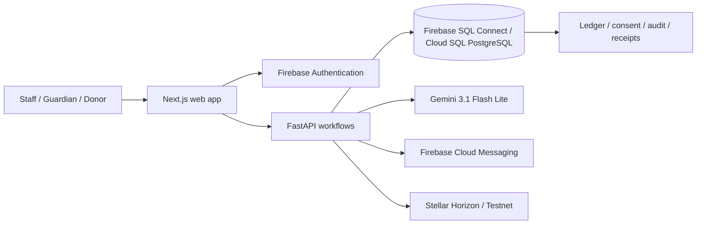

# HarambeeOne

<p align="center"></p>
<p align="center"><strong>Keeping learners in school by turning verified school needs into transparent, accountable support.</strong></p>
<p align="center"><a href="https://devfest-harambeeone.vercel.app/">Live application</a> | <a href="https://devfest-harambeeone.vercel.app/support">Public campaigns</a> | <a href="docs/MVP_ROADMAP.md">Delivery evidence</a></p>

## The problem

Uganda has expanded access to education, but getting a child into school is not the same as keeping that child there.

- **One in four Ugandan children aged 6-17 is out of school.**
- **Only three out of ten pupils who start primary school complete the seven-year cycle.**
- **Nearly 3.1 million children aged 13-18 are out of school**, and financial barriers are the main reason cited for non-attendance and dropout.
- At secondary level, households provide an estimated **62% of total education funding**, leaving education highly exposed when a family suffers a financial shock.

Sources: [UNICEF Uganda Country Programme 2026-2030](https://www.unicef.org/executiveboard/media/32616/file/2025-PL12-Uganda-CPD-EN-ODS.PDF) and [UNICEF's mapping of cash-plus programmes for education outcomes](https://www.unicef.org/uganda/reports/mapping-cash-plus-programmes-education-outcomes).

Dropout has several causes. HarambeeOne focuses on one that schools and communities can act on immediately: **a learner being pushed out because an unpaid fee or essential requirement is discovered too late, handled informally, or cannot be supported transparently.**

The information is often fragmented: a balance sits in a bursar's book, guardian communication happens outside the school record, and a willing donor has no safe way to verify the need, donate easily, or see where the support went.

## The solution

**HarambeeOne is a bursar-first school finance and learner-support platform.** It gives every learner a reliable financial record, identifies a real outstanding obligation, and - after guardian consent, learner assent, and school safeguarding review - turns that obligation into a verified support campaign.

A donor can contribute **without creating an account**. Progress changes only after settlement is verified. HarambeeOne posts the payment, allocation, learner-ledger credit, receipt, audit evidence, notifications, and campaign progress as one controlled workflow.

> HarambeeOne connects the learner who needs support, the school that verifies the need, and the donor who wants proof that the support reached its purpose.

```text
School records fees and requirements
  -> The ledger reveals a real education need
  -> Guardian consent and the learner's view are recorded
  -> Gemini checks privacy-minimized content for safeguarding risks
  -> Authorized staff make the publication decision
  -> A donor gives without registering
  -> Settlement is independently verified
  -> Learner account, receipt, progress and audit evidence update together
  -> Firebase sends privacy-safe updates
```

## Why HarambeeOne stands out

HarambeeOne is not a crowdfunding page beside a school system. The journey begins and ends inside the school's accountable financial record.

| Common failure | HarambeeOne's response |
| --- | --- |
| Unverified appeals | Every target is bounded by a live school obligation |
| Donor registration friction | Guest donation requires no account |
| Promises inflate totals | Only verified settlement counts as funded |
| Donations are hard to reconcile | Payment, allocation, ledger entry and receipt post together |
| Beneficiaries are overexposed | Consent, assent and safeguarding control publication |
| AI makes opaque decisions | Gemini advises; authorized people retain every decision |
| Donors lose visibility | Tracking, receipts, updates and testnet proof preserve accountability |
| Unexplained balances | An immutable exact-decimal ledger makes balances reproducible |

## Google technologies - used where they matter

Google technology provides HarambeeOne's identity, financial infrastructure, intelligence, and communication layers. It is not included merely to satisfy a checklist.

### Firebase Authentication

Firebase provides email/password and Google sign-in. A Firebase ID token becomes a Secure, HttpOnly server session. Firebase identity maps to a stable internal user ID so historical receipts and audits remain intact. Financial authority comes from server-verified roles and guardian relationships, never browser claims.

**Why it matters:** low-friction access without weakening financial authorization.

### Firebase SQL Connect and Cloud SQL for PostgreSQL

The deployed API uses Firebase-managed PostgreSQL with IAM authentication. PostgreSQL preserves exact-decimal money, transactions, row locks, foreign keys, immutable history, tenant isolation, and reproducible equations. FastAPI is the only writer for finance, consent, settlement, receipts, and audit state.

**Why it matters:** a donation cannot leave a partially updated campaign or learner account.

### Firebase Cloud Messaging

FCM delivers consented foreground and background notifications for invitations, consent, campaigns, contributions, settlement, receipts, and outcomes. Push sends only a generic event and authenticated deep link - never identity, balances, private narratives, payment references, or receipt numbers. In-app notifications remain authoritative.

**Why it matters:** timely updates without exposing a child on a notification screen.

### Gemini API

HarambeeOne uses free-tier **Gemini 3.1 Flash Lite** on the server for:

1. **Campaign safeguarding review:** flags identifying details, unsafe claims, evidence gaps, and redactions.
2. **Guardian assistance:** explains the guardian's own consent and support workflow.
3. **Donor assistance:** explains public campaigns and the donor's own contribution status.

Requests require consent, minimum facts, structured Pydantic output, time/token bounds, rate limits, and manual fallback. Questions and answers are not retained. Gemini **cannot** approve campaigns, determine eligibility, verify money, issue receipts, or change finance.

**Why it matters:** Gemini reduces review and comprehension friction while people retain authority.

### Google AI Studio

AI Studio was used to prototype and evaluate prompts against identifier leakage, prompt injection, cross-user extraction, authority claims, malformed output, uncertainty, latency, and failure. Runtime calls remain server-side through the Gemini API.

**Why it matters:** the model and prompts were evaluated against the real risks of this use case.

## Responsible AI and safeguarding

- Campaign preparation begins privately.
- Public identity is limited to a consented display name, approved image, and registration badge.
- Admission numbers, documents, contacts, exact class, guardian identity, and family context stay private.
- Guardian consent, learner assent, withdrawal, and school approval are enforceable.
- Gemini receives privacy-minimized facts only after separate consent.
- Model output is schema-validated advice, never authority.
- No learner identity is written to Stellar.
- Push notifications contain no private learner or financial data.

## Transparent donation demo

The build includes a **Stellar Testnet** flow so judges can see end-to-end verification without real money or an account.

1. Open [public campaigns](https://devfest-harambeeone.vercel.app/support).
2. Choose a campaign, enter an amount, and select **Transparent Stellar Testnet demo**.
3. Complete the free live Testnet transaction.
4. HarambeeOne verifies the account, amount, memo, network, and transaction through Horizon.
5. Campaign progress and the learner obligation update only after verification.
6. Track the gift and open its independent transaction proof.

Testnet XLM has no monetary value. SchoolPay, bank, and mobile-money methods appear only when a school configures and verifies real details.

## What success looks like

| Person | Successful outcome |
| --- | --- |
| Learner | A verified obligation is resolved and the learner remains engaged in school |
| Guardian | Consent is meaningful and support is visible in the learner account |
| School | Billing, allocation, receipt, reconciliation, and evidence agree |
| Donor | Giving takes under a minute, needs no account, and is trackable |
| Community | Support becomes easier to trust, audit, and direct |

We measure learners identified before exclusion, referral-to-publication time, complete consent evidence, verified allocation rate, unresolved-payment reduction, campaign completion time, next-period learner retention, and donor outcome updates.

## Sustainable Development Goals

- **SDG 4 - Quality Education:** helps financially vulnerable learners remain in education.
- **SDG 1 - No Poverty:** reduces the education impact of financial shocks.
- **SDG 10 - Reduced Inequalities:** connects verified needs to accessible support.
- **SDG 16 - Peace, Justice and Strong Institutions:** strengthens consent and accountability.
- **SDG 17 - Partnerships for the Goals:** coordinates learners, guardians, schools, donors, and technology.

## Architecture



| Layer | Technology | Responsibility |
| --- | --- | --- |
| Web | Next.js 15, React 19, TypeScript | Staff, guardian, and donor experiences |
| Identity | Firebase Authentication and Admin SDK | Sign-in and verified sessions |
| API | FastAPI, Pydantic, SQLAlchemy | Authorization, workflows, audit, and safe AI |
| Data | Firebase SQL Connect / Cloud SQL PostgreSQL | Transactional finance, consent, and audit |
| AI | Gemini 3.1 Flash Lite | Consented assistance and safeguarding |
| Messaging | Firebase Cloud Messaging | Privacy-safe web push |
| Demo settlement | Stellar Testnet and Horizon | Public, valueless proof |
| Deployment | Vercel and Render free tiers | Public web application and API |

The system also provides learner registration, class billing and requirements, payment allocation, receipts, reconciliation, arrears, sixteen reports, period closing, balance carry-forward, role-based access, and audit evidence.

```text
opening balance + net assessed - net collected = closing balance
```

## Security guarantees

- Money uses exact decimals.
- Records are tenant-scoped and consequential actions retain an actor.
- Posted history is corrected through linked entries, not deletion.
- Idempotency and constraints prevent duplicates.
- Pending contributions never count as received.
- Settlement and ledger updates succeed or fail atomically.
- Browser code receives no server credential.
- Gemini or push failure never blocks finance or manual review.

See [Security](docs/SECURITY.md) and the [Firebase/Gemini plan](docs/FIREBASE_GEMINI_MIGRATION_PLAN.md).

## Local development

```bash
git clone https://github.com/RockieRaheem/Devfest_HarambeeOne.git
cd Devfest_HarambeeOne
cp .env.example .env
pnpm install
uv sync --directory apps/backend
pnpm db:migrate
pnpm dev
```

Use `.env.example`; never expose server secrets through a `NEXT_PUBLIC_*` variable.

```bash
pnpm --filter @harambeeone/backend test
pnpm --filter @harambeeone/backend lint
pnpm --filter @harambeeone/web lint
pnpm typecheck
pnpm --filter @harambeeone/web build
```

## Release boundary

HarambeeOne is a zero-cost hackathon MVP, not yet a licensed payment processor. Stellar is Testnet-only. Real payment operation requires licensed-provider agreements, webhook verification, security testing, backups, incident procedures, and Ugandan legal and data-protection review.

## Documentation

- [Delivery roadmap](docs/MVP_ROADMAP.md)
- [Firebase and Gemini plan](docs/FIREBASE_GEMINI_MIGRATION_PLAN.md)
- [Architecture](docs/ARCHITECTURE.md)
- [Security](docs/SECURITY.md)
- [Developer handoff](docs/DEVELOPER_HANDOFF.md)
- [Donation deployment](docs/DONATION_DEPLOYMENT.md)

## License

HarambeeOne is released under the [MIT License](LICENSE).
